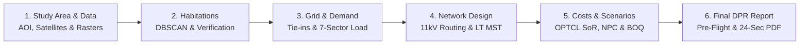

# ElectriMap DPR

[](https://github.com/Immortal-syntax/electrimap/actions/workflows/ci.yml)
[](https://electrimap-india.vercel.app)
[](LICENSE)
[](backend/)
[](backend/)
[](frontend/)
[](docker-compose.yml)
[](frontend/)

A web-based pre-feasibility GIS workbench for assessing rural and tribal electrification in India and generating 24-section Detailed Project Reports (DPRs) aligned with Rural Electrification Corporation (REC) and Revamped Distribution Sector Scheme (RDSS) standards.

---

## 🌐 Live Deployment & Interactive Access

| Environment | Access Link | Description |
|---|---|---|
| **Production Web App (Vercel)** | [**https://electrimap-india.vercel.app**](https://electrimap-india.vercel.app) | Static React/Vite GIS frontend (`frontend/dist`) + Vercel Analytics; requires `VITE_API_ORIGIN` pointing to a hosted `backend/` API for sign-in |
| **API Documentation (Local/Docker)** | [http://localhost:8000/docs](http://localhost:8000/docs) | Interactive OpenAPI/Swagger documentation for all 40+ REST endpoints |

### Pre-Configured Dev/Demo Accounts (Local / Docker `APP_ENV != production`)

| Account | Email | Password | Access Scope |
|---|---|---|---|
| **Swayam Kumar** | `swayamkr26@gmail.com` | `1234` | Full planner access; private project portfolio + shared Bheja Sample Study (disabled in `APP_ENV=production`) |
| **Sumit Kushwaha** | `sumitp@gmail.com` | `1234` | Full planner access; private project portfolio + shared Bheja Sample Study (disabled in `APP_ENV=production`) |
| **Instant Exploration** | *Click "Sample Study" in top bar* | *None* | Pre-feasibility benchmark exploration for Village Bheja, Koraput, Odisha |

---

## ⚡ Core Engineering Principles

1. **Epistemic Honesty**: Remote sensing and satellites cannot observe electricity meters. Satellite-derived proxy indicators (`LIKELY_ELECTRIFIED`, `POTENTIALLY_UNDERSERVED`, `POTENTIALLY_UNSERVED`, `UNKNOWN`) are explicitly classified as preliminary proxies and never labeled as ground-truth verified without field-survey confirmation.
2. **Four Electrification Dimensions**: Strictly separates:
   - Household connection coverage (Census & building footprints)
   - Electricity supply availability (nighttime lights and service hours)
   - Supply quality and voltage regulation
   - Distribution infrastructure adequacy (11 kV lines and Distribution Transformers)
3. **No Fabricated Infrastructure or Unit Rates**: Existing 11 kV feeders, LT lines, and DTs originate exclusively from uploaded GIS datasets or explicit `USER_ASSUMED` tie-in placements. Missing unit costs are left `UNSET` and block DPR export rather than being hallucinated.
4. **Preliminary Engineering Watermarks**: All network layouts, minimum spanning tree (MST) LT circuits, and least-cost feeder paths carry clear preliminary watermarks requiring ground validation before tender issuance.
5. **Zero-Paid-API Architecture**: Operates exclusively with open datasets (Copernicus DEM, Sentinel-2, OpenStreetMap, Google/Microsoft Open Buildings, NASA POWER, and Census 2011) without paid commercial API dependencies.

---

## 🗺️ The 6-Step Engineering Workflow



1. **Step 1 — Study Area & Map Data**: Define your study boundary via administrative cascade (State $\rightarrow$ District $\rightarrow$ Block $\rightarrow$ Village), custom drawing, or GeoJSON/Shapefile/KML upload. Ingest Copernicus DEM 30m terrain, Sentinel-2 optical imagery, OpenStreetMap vectors, and NASA POWER solar data.
2. **Step 2 — Villages & Habitations**: Automatically extract dense residential clusters using metric UTM DBSCAN clustering. Reconcile with Census 2011 village demographics and record immutable 2-Axis field verifications.
3. **Step 3 — Grid & Demand**: Register existing 11 kV tie-in points or upload utility GIS line files. Perform 3D terrain-weighted distance gap analysis and forecast 10-year compound electricity demand across 7 consumer sectors (Domestic, Commercial, Agricultural, Institutional, etc.).
4. **Step 4 — Network Design**: Compute REC-compliant Distribution Transformer sizing (16, 25, 63, 100 kVA). Route 11 kV primary lines along least-cost terrain corridors, generate 3-phase LT circuits using Minimum Spanning Trees (MST), and verify IEEE voltage drop limits.
5. **Step 5 — Costs & Scenarios**: Compare 10-year Net Present Cost (NPC) and Levelized Cost of Energy (LCOE) across `GRID_ONLY`, `MINIGRID_ONLY`, `SHS_ONLY`, and `HYBRID_OPTIMAL` modalities. Customize unit prices via interactive Schedule of Rates (SoR) with 4-column expandable Bill of Quantities (BOQ).
6. **Step 6 — Final Check & Report**: Run the 18-point automated Pre-Flight Data Integrity Audit. Export the complete, publication-grade 24-Section ReportLab PDF DPR, multi-sheet formula-driven Excel BOQ, and cleaned GIS vector package with SHA-256 cryptographic provenance logs.

---

## 🏗️ Architecture & Technology Stack

| Layer | Technologies | Purpose |
|---|---|---|
| **Frontend** | React 18, TypeScript (strict), Vite, Tailwind CSS, Radix UI, TanStack Query, Zustand | High-density cartographic workbench UI, responsive drawer architecture, accessible dialogs |
| **Mapping & GIS** | MapLibre GL JS, Terra Draw, GeoJSON, Vector Tiles (MVT) | WebGL-accelerated 6-layer overlay visualization, AOI digitizing, interactive asset inspector |
| **Backend API** | Python 3.12+, FastAPI, Pydantic v2, SQLAlchemy 2.0, GeoAlchemy2, Alembic | REST API, CRS reprojection, authentication, optimistic concurrency, and input validation |
| **Pure Domain Math** | GeoPandas, Shapely 2, PyProj, Rasterio, scikit-learn (DBSCAN), SciPy | Pure mathematical algorithms: least-cost routing, voltage drop, and demand growth |
| **Database & Queue** | PostgreSQL 16 + PostGIS 3.4 (or SQLite in-memory for testing) | Spatial persistence, transactional background job queue (`SKIP LOCKED`) |
| **Reporting & Exports** | ReportLab Platypus, Matplotlib, openpyxl | Multi-page 24-section PDF DPR compilation, 5-sheet formula-driven Excel BOQ |
| **Cloud Deployment** | Vercel (Frontend), Docker Compose (Full Stack) | Production serverless hosting with Vercel Web Analytics and containerized multi-service deployment |

---

## 🚀 Getting Started

### Prerequisites

- **Node.js**: 20 LTS or later
- **Python**: 3.12 or 3.13
- **Docker**: For running PostgreSQL 16 with PostGIS 3.4 (optional for local testing; SQLite in-memory supported)
- **GDAL / PROJ**: Geospatial libraries (included automatically in Docker or installed via wheels)

---

### Option A: One-Command Docker Deployment (Full Stack)

Deploy the entire stack with database, backend, background worker, and frontend:

```bash
docker compose up -d --build
```

- **Frontend UI**: [http://localhost:5173](http://localhost:5173)
- **Backend API**: [http://localhost:8000](http://localhost:8000)
- **API Documentation**: [http://localhost:8000/docs](http://localhost:8000/docs)

---

### Option B: Local Developer Setup

#### 1. Database Setup

```bash
# Launch PostGIS container
docker compose up db -d
```

#### 2. Backend Setup

```bash
cd backend

# Create virtual environment
python -m venv .venv
# Activate virtual environment
source .venv/bin/activate       # On Linux/macOS
.\.venv\Scripts\Activate.ps1    # On Windows PowerShell

# Install dependencies in editable mode
pip install -e ".[dev]"

# Run database migrations
alembic upgrade head

# Seed initial admin units, users, and demo study
python -m app.services.seed_service

# Start the FastAPI development server
uvicorn app.main:app --reload --port 8000
```

#### 3. Frontend Setup

```bash
cd frontend

# Install dependencies (including devDependencies required for tsc)
npm install

# Start the Vite development server
npm run dev
```

The frontend will be accessible at [http://localhost:5173](http://localhost:5173).

---

## ☁️ Vercel + Backend Deployment Guide

Vercel hosts only the static Vite frontend (`frontend/dist`). Sign-in, authentication cookies, PostGIS queries, and DPR PDF/Excel exports require hosting [`backend/`](backend/Dockerfile) separately (e.g., Railway, Render, Cloud Run, or Docker) and linking its public URL via `VITE_API_ORIGIN`:

### 1. Connecting & Deploying the Frontend on Vercel
1. Ensure Vercel (`electrimap-india`) is linked to `Immortal-syntax/electrimap` (`main` branch) in **Vercel Dashboard → Settings → Git** and trigger a **Redeploy** whenever `main` updates.
2. Root [`vercel.json`](vercel.json) and [`frontend/vercel.json`](frontend/vercel.json) isolate `/api/*` and `/_vercel/*` from SPA HTML rewrites, preventing `HTTP 405` on API requests and HTML `SyntaxError` on `/_vercel/insights/script.js`.
3. Enable **Web Analytics** in the Vercel Project Analytics tab so `/_vercel/insights/script.js` is served cleanly.

### 2. Connecting the FastAPI + PostGIS Backend
1. Deploy [`backend/Dockerfile`](backend/Dockerfile) with PostgreSQL 16 + PostGIS 3.4 (the container automatically binds `${PORT:-8000}`).
2. Configure backend environment variables:
   - `APP_ENV=production` (or `demo` if you explicitly want sample demo accounts enabled; otherwise set `PRODUCTION_ADMIN_EMAIL` and `>=12`-char `PRODUCTION_ADMIN_PASSWORD`)
   - `SESSION_SECRET=<64-char-random-secret>`
   - `SESSION_COOKIE_SAMESITE=none` (required for cross-origin cookies between `electrimap-india.vercel.app` and an external API domain over HTTPS)
   - `CORS_ORIGINS=https://electrimap-india.vercel.app`
3. In **Vercel → Settings → Environment Variables**, set:
   - `VITE_API_ORIGIN=https://<your-hosted-backend-domain>`
4. Redeploy the Vercel project so Vite embeds `VITE_API_ORIGIN` into the production bundle.

---

## 🛡️ Quality Gates & Verification

ElectriMap maintains strict continuous verification across the entire codebase:

### Backend Quality Suite

```bash
cd backend

# 1. Fast linting and import formatting
ruff check app tests

# 2. Strict static typechecking
mypy app

# 3. Comprehensive unit and integration test suite (71 tests)
pytest -v
```

### Frontend Quality Suite

```bash
cd frontend

# 1. ESLint syntax and accessibility verification (0 warnings)
npm run lint

# 2. Strict TypeScript type verification (0 errors)
npm run typecheck

# 3. Vitest unit and component tests (58 tests)
npm run test

# 4. Production build compilation
npm run build
```

---

## 📜 Directory Structure

```text
electrimap/
├── .github/                  # GitHub Actions CI workflows, issue & PR templates
├── backend/
│   ├── app/
│   │   ├── api/v1/           # FastAPI routers (auth, projects, aoi, jobs, planning, etc.)
│   │   ├── core/             # Configuration, logging, security, and CSRF protection
│   │   ├── db/               # SQLAlchemy models and database session management
│   │   ├── domain/           # Pure, side-effect-free GIS, demand, and engineering math
│   │   ├── schemas/          # Pydantic v2 request and response contracts
│   │   └── services/         # Orchestration services and database interaction
│   ├── migrations/           # Alembic database migrations
│   └── tests/                # Pytest unit and integration test suite
├── frontend/
│   ├── src/
│   │   ├── components/       # Radix UI and survey-sheet workspace components
│   │   ├── pages/            # Application views (Landing, Projects, Workspace, etc.)
│   │   ├── stores/           # Zustand state management
│   │   └── types/            # Strict TypeScript interfaces
│   ├── vercel.json           # Vercel deployment and routing configuration
│   └── vite.config.ts        # Vite build and worker optimization configuration
├── docs/                     # PRD, Architecture, Design System, User Manual, and Audits
├── data/reference/           # Calibrated reference datasets for Koraput, Odisha
├── scripts/                  # Data access spikes, routing spikes, and verification utilities
├── vercel.json               # Root monorepo Vercel deployment configuration
└── docker-compose.yml        # Multi-container production deployment specification
```

---

## 📄 License & Attribution

ElectriMap DPR is licensed under the [Apache License, Version 2.0](LICENSE).

See the [NOTICE](NOTICE) file for required third-party data source attributions, including:
- **Copernicus DEM GLO-30**: © European Space Agency (ESA) & Airbus Defence and Space
- **Sentinel-2 Cloudless**: © EOX IT Services GmbH & Copernicus Sentinel data
- **OpenStreetMap**: © OpenStreetMap contributors (ODbL)
- **Open Buildings**: Google Research & Microsoft AI for Good (VIDA)
- **NASA POWER**: NASA Langley Research Center Agroclimatology & Solar Radiation Project
- **Census of India 2011**: Office of the Registrar General & Census Commissioner, India
