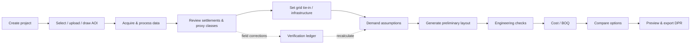
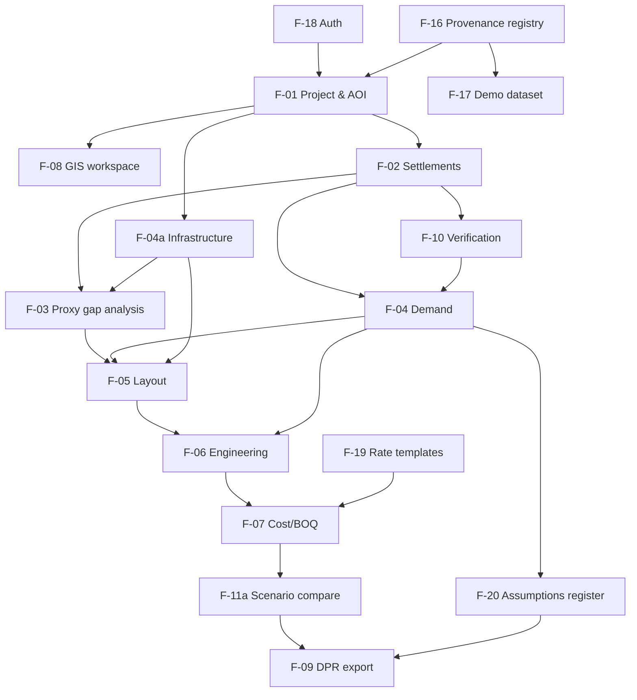

# PRD.md — ElectriMap DPR (DRAFT, Prompt 1)

> **Version:** 0.1-draft · **Date:** 2026-11-05 · **Status:** Awaiting approval
> **Basis:** Approved Prompt 0 (Deliverables A–J) and PROJECT_CONTEXT.md (draft).
> **Constraints:** Free resources only · college-level, professional documentation standard · India first, extensible.
> **Conventions:** `FR-` functional requirement · `NFR-` non-functional requirement · `US-` user story · `AC-` acceptance criterion · Priority **P0** = must have (MVP), **P1** = important (after MVP), **P2** = future.

---

## 1. Product Objectives

| ID | Objective | Measurable target for the MVP |
|---|---|---|
| O1 | Find potentially unserved/underserved habitations within an AOI | For the reference AOI, every building cluster gets a proxy class, a confidence value and the evidence used |
| O2 | Estimate households and demand transparently | Every household and demand figure shows its inputs, assumptions and data-quality tag |
| O3 | Propose a preliminary electrification strategy per habitation | Each habitation gets a recommended option (grid / mini-grid / solar home system) with the cost comparison that justifies it |
| O4 | Produce traceable engineering and cost outputs | Every DPR calculation reproduces from the stated formula and inputs. Engineering-module unit tests match hand-worked examples |
| O5 | Generate a usable DPR | A 24-section PDF, an Excel BOQ and a GeoJSON package are generated from real project data, with no placeholder text in populated sections |
| O6 | Capture ground truth | Field corrections update classifications and downstream results without overwriting the original data, and are fully audited |
| O7 | Zero recurring cost | The core workflow runs without paid services or mandatory API keys |

**Non-objectives (MVP):** construction-ready design, load-flow simulation, live machine-learning detection on raw imagery, utility system integration, monetisation.

---

## 2. Target Audience & Personas

Personas are **hypothetical** (see PROJECT_CONTEXT.md §5). The MVP is optimised for **P1 Planning Engineer** and **P5 Academic Evaluator**. P2/P3 are served by the same workflow. P4 Field Verifier gets a minimal desktop override and CSV import in the MVP; a mobile field mode is P1/P2.

---

## 3. Core User Journeys

| Journey | Persona | Steps | Success condition |
|---|---|---|---|
| **J1 – Desk assessment to DPR** | P1 | Create project → choose AOI → automatic data processing → review clusters → set tie-in → accept/edit demand tier → generate layout → resolve voltage-drop failures → review BOQ → export DPR | PDF, Excel and GeoJSON downloaded; every figure traceable |
| **J2 – Field correction loop** | P4 / P1 | Open project → select cluster/building → record verified status with evidence (or import CSV) → system recalculates → DPR shows verified counts | Ledger entry created; original value kept; downstream figures updated |
| **J3 – Option comparison** | P2 / P3 | Open project → force options per habitation → compare NPC/LCOE/CapEx → pin the chosen scenario for the DPR | DPR states the chosen scenario and why |
| **J4 – Rate template management** | Admin / P1 | Upload a state rate CSV → validate → apply to project → BOQ shows rate provenance | Every BOQ line shows its rate source |
| **J5 – Methodology audit** | P5 | Open the demo project → inspect provenance panel, formula drawer and assumptions register → open the DPR methodology sections | An evaluator can trace any output to its source without developer help |

---

## 4. Feature Inventory

The feature IDs F-01 to F-15 continue from Prompt 0 Deliverable B. F-16 to F-22 are added in this PRD.

| ID | Feature | Priority | Depends on | Notes |
|---|---|---|---|---|
| F-01 | Project creation & AOI selection (LGD/Census lookup, search, draw, upload GeoJSON/Shapefile/KML, CRS validation, boundary fallback tiers) | **P0** | F-16 | Core entry point |
| F-02 | Building-footprint ingestion, residential filtering, DBSCAN habitation clustering | **P0** | F-01, F-16 | Uses precomputed open footprints only |
| F-03 | Proxy electrification gap analysis (night lights, distance, density → proxy class and confidence) | **P0** | F-02, F-04a | Shown with evidence breakdown |
| F-04a | Existing-infrastructure handling (OSM power import, GeoJSON upload, manual tie-in placement, provenance labels) | **P0** | F-01 | Split out from Prompt 0 Module 4 for clarity |
| F-04 | Parametric demand estimation (7 categories, tiers, growth projection) | **P0** | F-02 | Every value editable |
| F-05 | Preliminary network layout & strategy selection (DT placement, HT terrain-weighted routing, LT spanning tree, mini-grid/SHS assignment) | **P0** | F-03, F-04, F-04a | Watermarked as preliminary |
| F-06 | Deterministic engineering calculations (Prompt 0 Calc 1–10) | **P0** | F-04, F-05 | Constants are provisional until source-verified (see Validation C3) |
| F-07 | Cost estimation & editable BOQ (reference rates, rate-source tags, terrain multiplier, GST, contingency, cost per HH/village) | **P0** | F-05, F-06, F-19 | No fabricated "current prices" |
| F-08 | Interactive GIS workspace (MapLibre-class WebGL map, layer tree, legends, inspector, measure, basemap switch) | **P0** | F-01 | The map is the primary interface |
| F-09 | DPR generation (24-section PDF with cartographic maps, Excel BOQ, GeoJSON/CSV export) | **P0** | F-02 to F-07, F-11a | Sections with no data must say so explicitly |
| F-10 | Field-verification override & audit ledger (single edit and CSV import) | **P0** | F-02, F-03 | Photos are P1 |
| F-11a | Basic scenario comparison (grid vs mini-grid vs SHS vs hybrid: CapEx, NPC, LCOE) | **P0** | F-06, F-07 | Required to justify the chosen strategy |
| F-11b | MCDA prioritisation with editable, documented weights | **P1** | F-11a | *Proposed move from MVP to P1 — see Validation C5* |
| F-12 | Multi-temporal VIIRS & Sentinel-2/WorldCover obstacle screening | P1 (WorldCover forest/water flag: **P0**) | F-05 | The single-year WorldCover routing penalty is needed by P0 routing |
| F-13 | Mobile field-survey mode (offline PWA, GPS, photos) | P2 | F-10 | |
| F-14 | Custom deep-learning building detection on user imagery | P2 | — | Excluded from MVP (Prompt 0) |
| F-15 | Unbalanced 3-phase load flow / protection | P2 | — | Excluded from MVP (Prompt 0) |
| **F-16** | Data acquisition & provenance registry (dataset metadata, licence, date, resolution, cache, fallback status) | **P0** | — | New: makes provenance a first-class feature |
| **F-17** | Reference demo dataset (Koraput, Odisha: one block, pre-processed) | **P0** | F-16 | New: works offline and at demo time |
| **F-18** | Authentication & project ownership | **P0** (minimal) | — | New: see §10 |
| **F-19** | Admin: rate templates, global default assumptions, dataset registry, users | P0 (rate templates + defaults) / P1 (user management UI) | F-18 | New |
| **F-20** | Assumptions register (project-level list of every active assumption, its value, source and whether the user edited it) | **P0** | F-04 to F-07 | New: feeds DPR Section 21 |
| **F-21** | Project history & snapshots (versioned DPR exports, parameter-change log) | P1 (DPR export log: **P0**) | F-10 | |
| **F-22** | Product analytics / internal event log (no third-party trackers) | P1 (error log: **P0**) | F-18 | See §12 |

---

## 5. MVP Scope

### 5.1 In scope (P0)
F-01, F-02, F-03, F-04a, F-04, F-05, F-06, F-07, F-08, F-09, F-10, F-11a, F-16, F-17, F-18 (minimal), F-19 (rate templates and defaults), F-20, WorldCover forest/water screening (part of F-12), DPR export log, error log.

### 5.2 Explicitly out of scope for the MVP
- Training or running vision models on raw imagery (F-14)
- Load flow and protection studies (F-15)
- Offline mobile PWA and photo capture (F-13)
- MCDA weight workbench (F-11b), *pending approval of C5*
- Multi-organisation tenancy, SSO and utility system integration
- Any paid imagery, tiles, geocoding or hosting
- Hindi / regional-language UI (P2; English in MVP)
- Automatic scheduled data refresh

### 5.3 MVP screen set (proposed consolidation — Validation C4)
The 15 pages specified in Prompt 0 are kept as **functional areas**. In the MVP most of them live inside one project workspace as tabs/panels:

| MVP route | Contains Prompt 0 pages |
|---|---|
| `/` Landing | 1 |
| `/login` | — |
| `/projects` Dashboard & history | 2, 14 (list) |
| `/projects/new` Create + AOI wizard | 3, 4 |
| `/projects/:id/workspace` Map workspace with tabs: **Data · Settlements · Infrastructure · Planning · Engineering · Cost · Compare** | 5, 6, 7, 8, 9, 10, 11, 12 |
| `/projects/:id/report` DPR preview & export | 13 |
| `/projects/:id/audit` Verification ledger & change log | 14 |
| `/settings` Defaults, rate templates, data sources, API health | 15 |

---

## 6. Functional Requirements

### 6.1 Module 1 — Projects & AOI (F-01)
- **FR-1.1** Create, rename, duplicate, archive and delete (soft delete) projects. Each project has name, description, target scheme (`RDSS`, `PM-JANMAN`, `DAJGUA`, `Custom`), planning horizon (default 10 years), base year, discount rate and load-tier preset.
- **FR-1.2** Select AOI by cascading State → District → Sub-district/Block → Village, using LGD codes and linking Census 2011 codes where a mapping exists.
- **FR-1.3** Search villages by name using a local index (no paid geocoder). An external free geocoder may be used as a fallback, within its usage policy (rate-limited and cached).
- **FR-1.4** Draw and edit polygon AOIs on the map.
- **FR-1.5** Upload GeoJSON, zipped Shapefile (.shp/.shx/.dbf/.prj) and KML. Detect the CRS and reproject to EPSG:4326. Reject files with no CRS that cannot be inferred, and explain why.
- **FR-1.6** Validate geometry: fix or reject invalid geometry, require the AOI to fall within India's bounding extent, enforce a maximum AOI area (default 500 km², configurable by admin), and enforce limits on file size and vertex count.
- **FR-1.7** Boundary fallback tiers: (1) harmonised village polygon; (2) centroid buffer / clipped Voronoi labelled `APPROXIMATE_BUFFER`; (3) user-drawn or uploaded AOI. The boundary source label is shown on the map and in the DPR.
- **FR-1.8** Show AOI area, bounding box, centroid, boundary source and Census baseline (if linked) before the user confirms.

### 6.2 Module 2 — Data Acquisition & Provenance (F-16, F-17)
- **FR-2.1** On AOI confirmation, run a background data job: footprints, DEM/slope, night lights, OSM roads/water/power/amenities, land cover, solar resource. Report progress per layer.
- **FR-2.2** For every layer, record: source name, URL, licence, publication/acquisition date, spatial resolution, retrieval timestamp, feature/pixel count and status (`READY`, `FAILED`, `CACHED_FALLBACK`, `NOT_AVAILABLE`).
- **FR-2.3** If a source is unavailable, mark the layer `NOT_AVAILABLE` or use a clearly labelled cached copy. **Never substitute synthetic data.**
- **FR-2.4** Ship a pre-processed reference dataset for one Koraput block, so the full workflow runs without internet access.
- **FR-2.5** Users can upload extra layers (existing infrastructure, household survey points, amenities) as GeoJSON or CSV with lat/lon columns.

### 6.3 Module 3 — Settlements & Households (F-02, F-03)
- **FR-3.1** Clip footprints to the AOI and filter by confidence (default ≥ 0.70, editable). Compute area in a metric CRS.
- **FR-3.2** Classify footprints by area: noise (< 9 m²), small outbuilding (9–12 m²), candidate residential (12–250 m²), candidate non-residential (> 250 m²). Thresholds are editable.
- **FR-3.3** Cluster residential footprints with DBSCAN (default ε = 150 m, min_samples = 5, editable). Noise points become "isolated homesteads".
- **FR-3.4** Estimate households per cluster: residential buildings × calibration factor α (default 0.90). Where village census data exists, show the reconciliation against projected census households and flag differences above 30%.
- **FR-3.5** Display separately: detected buildings · residential buildings · estimated households · verified households · verified unserved households.
- **FR-3.6** Compute a proxy class and confidence per cluster from night-light statistics, distance to known/assumed infrastructure, distance to roads and cluster size. Show the contribution of each input ("why this class").
- **FR-3.7** Clusters with no usable night-light data, or with conflicting evidence, are classed `UNKNOWN` rather than forced into a class.

### 6.4 Module 4 — Infrastructure & Gap Analysis (F-04a)
- **FR-4.1** Import OSM power features in the AOI plus a buffer (default 10 km), labelled `OSM` with retrieval date.
- **FR-4.2** Users upload infrastructure (lines, poles, DTs, substations) or digitise it manually. Each feature carries provenance: `UTILITY_RECORD`, `FIELD_SURVEY`, `USER_ASSUMED`, `OSM`.
- **FR-4.3** Grid-extension planning requires at least one tie-in point. If none exists, the planner blocks with a message asking the user to place an *assumed* tie-in point. The system never creates one silently.
- **FR-4.4** For each cluster compute straight-line distance, terrain-weighted path distance, mean/max slope, forest/water crossings and distance to the nearest road.

### 6.5 Module 5 — Demand (F-04)
- **FR-5.1** Seven load categories (residential, education, health, street lighting, water pumping, community buildings, commercial/livelihood), with per-unit load, demand factor, hours and counts.
- **FR-5.2** Three preset tiers (Basic, Standard, Productive). All values are editable per project and per cluster.
- **FR-5.3** Compute connected load, category maximum demand, coincident peak (kW, kVA), daily and annual energy, and projected peak at the horizon year (Prompt 0 Calc 1–2).
- **FR-5.4** Every demand output is labelled `ESTIMATED (assumption-based)`. Measured demand can only be entered as `USER_ENTERED` with a source note.

### 6.6 Module 6 — Planning & Layout (F-05)
- **FR-6.1** Per-cluster strategy mode: `AUTO_LEAST_COST`, `FORCE_GRID`, `FORCE_MINIGRID`, `FORCE_SHS`.
- **FR-6.2** Place DTs at the demand-weighted location snapped to an accessible point. Split a cluster when the LT radial distance would exceed the limit (default 500 m).
- **FR-6.3** Route the 11 kV extension as a least-cost path over a slope/land-cover/road-weighted grid, from the tie-in point to each DT.
- **FR-6.4** Generate LT networks as a minimum spanning tree from the DT to building groups, and compute pole counts by span length.
- **FR-6.5** Users can move DTs and edit route vertices. Edited elements are marked `USER_EDITED` and recalculated.
- **FR-6.6** All layout geometry is labelled "Preliminary — requires field peg-marking and utility validation" on the map and in exports.

### 6.7 Module 7 — Engineering (F-06)
- **FR-7.1** Implement Prompt 0 Calculations 1–10, with inputs, formula, units and result shown per element.
- **FR-7.2** Check voltage drop against configurable limits (defaults: LT 6%, HT 5%) and flag failures. Offer two remedies: upsize the conductor or split the DT.
- **FR-7.3** Engineering constants (conductor R/X, ampacity, DT losses, standard ratings) live in an editable reference table. Each constant carries a source citation and a status: `SOURCE_VERIFIED` or `PROVISIONAL`.
- **FR-7.4** Solar sizing uses worst-month irradiance from the cached solar resource for the cluster location.

### 6.8 Module 8 — Cost (F-07, F-19)
- **FR-8.1** The BOQ is generated from layout and sizing quantities and grouped by HT, DT, LT, service connections, mini-grid, SHS, civil and overheads.
- **FR-8.2** Every unit rate shows its source: `REFERENCE_PUBLIC_DOCUMENT` (with citation and year), `USER_TEMPLATE` or `USER_EDITED`. If a rate has no known source it is `UNSET`, it blocks the DPR, and it is never fabricated.
- **FR-8.3** Configurable terrain multiplier, GST %, PMC %, contingency %, and an O&M % or annual amount.
- **FR-8.4** Outputs: total CapEx, cost per estimated household, cost per village, NPC and LCOE per option.
- **FR-8.5** Rate templates can be imported from CSV (validated schema) and exported.

### 6.9 Module 9 — Coverage & Comparison (F-11a; F-11b is P1)
- **FR-9.1** Coverage metrics: estimated households, potentially unserved/underserved households, verified unserved households, proposed connections by option, expected coverage after implementation, population benefited (households × editable household size).
- **FR-9.2** Side-by-side scenarios: all-grid, all-off-grid, recommended hybrid. The user pins one scenario as the DPR baseline.

### 6.10 Module 10 — DPR (F-09)
- **FR-10.1** Generate the 24-section PDF defined in Prompt 0 Deliverable F from the pinned scenario.
- **FR-10.2** Each of the four maps includes a legend, scale bar, north arrow, coordinate grid or extent coordinates, CRS label, data dates and attribution.
- **FR-10.3** Each value carries its data-quality tag. If no field verification exists, every page shows a "Not field verified" watermark.
- **FR-10.4** Sections without data state "No data available — reason: …". They are never padded with filler text.
- **FR-10.5** Excel workbook with live formulas (summary, settlements and demand, engineering, BOQ, scenarios) and a GeoJSON/CSV package.
- **FR-10.6** A pre-flight checklist blocks export on hard errors (unset rates, missing tie-in for grid clusters, failed calculations) and warns on soft issues (no verification, cached data).
- **FR-10.7** Each export is logged with a timestamp, project snapshot hash and file hash.

### 6.11 Module 11 — GIS Workspace (F-08)
- **FR-11.1** Basemaps: free vector street map and free satellite/terrain imagery (provider chosen in Prompt 2 under the free-licence constraint).
- **FR-11.2** Layers: AOI, admin boundary, footprints (styled by class), clusters (styled by proxy/verified class), night lights, slope, land cover, roads, existing infrastructure (by provenance), proposed HT/LT/DT, mini-grid/SHS zones.
- **FR-11.3** Layer toggle, opacity, a legend that updates automatically, feature inspector, distance/area measurement, cursor coordinates (lat/lon, UTM, elevation).
- **FR-11.4** Filters by cluster, proxy class, verification state and strategy option.
- **FR-11.5** Selecting a table row and selecting a map feature stay in sync, in both directions.

### 6.12 Module 12 — Verification (F-10)
- **FR-12.1** Users override a cluster or building class with an evidence type (`FIELD_SURVEY`, `UTILITY_RECORD`, `MANUAL_INSPECTION`), note, date and verifier name.
- **FR-12.2** CSV import with columns: lat, lon, household_id (optional), status, evidence_type, date, verifier, note. Points snap to the nearest building/cluster within a tolerance (default 30 m). Unmatched rows are reported, not dropped.
- **FR-12.3** Overrides go into an append-only ledger (previous value, new value, actor, timestamp). Source data is never modified. A reversal is a new ledger entry.
- **FR-12.4** Downstream recalculation runs after an override, and the DPR counts verified and estimated values separately.

---

## 7. User Stories & Acceptance Criteria

**US-01 (F-01) — Select an AOI.** *As a planning engineer, I want to pick a village or upload a boundary so that my assessment covers the right area.*
- AC-01.1 Given a valid zipped Shapefile in EPSG:32644, when it is uploaded, then the AOI shows correctly on the map in EPSG:4326 and the reported area is within 0.5% of a QGIS-computed area.
- AC-01.2 Given a self-intersecting polygon, when it is uploaded, then the system either repairs it (and tells the user) or rejects it with the reason.
- AC-01.3 Given an AOI larger than the cap, when it is submitted, then it is rejected, and the message shows the cap and the actual area.
- AC-01.4 Given a village with no polygon, when it is selected, then the system offers the buffer fallback and labels it `APPROXIMATE_BUFFER`.

**US-02 (F-16) — See where data came from.** *As an evaluator, I want every layer's source, date and licence so that I can judge reliability.*
- AC-02.1 Every layer in the provenance panel has source, URL, licence, date, resolution and status.
- AC-02.2 When a source request fails, the layer status is `FAILED` or `CACHED_FALLBACK`, and no synthetic features appear.

**US-03 (F-02) — Identify habitations.** *As a planning engineer, I want buildings grouped into habitations, with household estimates.*
- AC-03.1 On a fixed reference fixture, clustering produces the same cluster count on every run (deterministic).
- AC-03.2 Each cluster panel shows detected buildings, residential buildings, estimated households and verified households as separate figures.
- AC-03.3 Changing ε, min_samples or the area thresholds re-runs clustering and updates the counts.

**US-04 (F-03) — See likely gaps.** *As a block officer, I want to see which habitations are potentially unserved and why.*
- AC-04.1 Each cluster has a proxy class, a confidence value and a breakdown of contributing evidence.
- AC-04.2 No cluster without field/utility evidence is ever labelled "verified".
- AC-04.3 A cluster missing night-light data is `UNKNOWN`.

**US-05 (F-04a) — Define the grid connection.** *As a planning engineer, I want to set where the existing grid is so that extensions are realistic.*
- AC-05.1 Grid planning for a cluster cannot run without a tie-in point. The UI explains how to add one.
- AC-05.2 A manually placed tie-in is styled and labelled `USER_ASSUMED` on the map and in the DPR.

**US-06 (F-04) — Estimate demand.** *As a planning engineer, I want editable demand assumptions so that I can test scenarios.*
- AC-06.1 Using the Prompt 0 worked example inputs (60 HH, 1 school, 1 pump, 20 street lights), the results match: peak 19.11 kW / 22.48 kVA, 139.15 kWh/day (±0.5%).
- AC-06.2 Editing any assumption recalculates the outputs and records the change in the assumptions register.

**US-07 (F-05) — Get a preliminary layout.** *As a planning engineer, I want an automatic layout that respects terrain.*
- AC-07.1 The generated HT route avoids cells marked as water unless the crossing span is within the configured limit.
- AC-07.2 No LT radial path exceeds the configured maximum. If it would, the cluster is split.
- AC-07.3 Every layout element carries the "Preliminary" label in map popups and exports.

**US-08 (F-06) — Check engineering validity.** *As a planning engineer, I want voltage drop and loss checks.*
- AC-08.1 Calculation unit tests reproduce the Prompt 0 worked examples (DT 63 kVA; LT ΔV ≈ 1.99%; PV ≈ 52.8 kWp; BESS ≈ 228.7 kWh) to within ±1%.
- AC-08.2 A feeder over the voltage-drop limit is flagged red, and the suggested fix resolves it on re-run.
- AC-08.3 Each constant shows its source status (`SOURCE_VERIFIED` / `PROVISIONAL`).

**US-09 (F-07) — Estimate cost.** *As a planning engineer, I want a BOQ whose rates I can trace and replace.*
- AC-09.1 Every BOQ line shows quantity, unit, rate, rate source and total. The grand total equals the sum of the lines plus the configured percentages.
- AC-09.2 Importing a valid rate CSV updates the rates. An invalid CSV is rejected with row-level errors.
- AC-09.3 Any `UNSET` rate blocks DPR export with a specific message.

**US-10 (F-11a) — Compare options.** *As a tribal development officer, I want grid vs off-grid compared.*
- AC-10.1 The comparison shows CapEx, NPC, LCOE and households served per option, using the same demand inputs for every option.
- AC-10.2 The pinned scenario is the one used in the DPR.

**US-11 (F-09) — Export a DPR.** *As a planning engineer, I want a professional PDF, Excel and GeoJSON export.*
- AC-11.1 The PDF contains all 24 sections, in order. Section 8 cluster counts equal the workspace counts.
- AC-11.2 Each map page shows a legend, scale bar, north arrow, coordinates, CRS and attribution.
- AC-11.3 Excel totals recalculate in a spreadsheet application, and the BOQ total equals the PDF BOQ total.
- AC-11.4 The GeoJSON opens in QGIS with the correct positions and attributes.

**US-12 (F-10) — Record ground truth.** *As a field verifier, I want to correct classifications with evidence.*
- AC-12.1 An override creates a ledger entry and leaves the source record unchanged.
- AC-12.2 In a CSV import, unmatched rows are listed with the reason. Matched rows update classes and counts.
- AC-12.3 After verification, the DPR shows verified and estimated counts separately.

**US-13 (F-18) — Secure my projects.** *As a user, I want only authorised people to see or change my projects.*
- AC-13.1 An unauthenticated request to any project API returns 401. A request by a non-owner/non-member returns 403/404.
- AC-13.2 Passwords are stored only as salted hashes.

**US-14 (F-17) — Run the demo offline.** *As an evaluator, I want to run the full workflow without internet access.*
- AC-14.1 With network access disabled, the reference project goes from AOI to DPR export without errors, using bundled data.

---

## 8. Non-Functional Requirements

| ID | Category | Requirement |
|---|---|---|
| NFR-01 | Cost | Zero paid services. The core workflow requires no paid API keys. Free services are used within their published usage policies |
| NFR-02 | Performance | For an AOI ≤ 100 km² with ≤ 50,000 footprints: data job ≤ 3 min with warm cache; clustering ≤ 30 s; demand/cost recalculation ≤ 2 s; map stays interactive (target ~30+ fps on a mid-range laptop) |
| NFR-03 | Performance | DPR PDF generation ≤ 60 s for the reference project |
| NFR-04 | Reliability | No external outage blocks the reference project. Failed sources degrade to labelled states |
| NFR-05 | Correctness | Metric operations run in a projected metric CRS. Engineering functions have unit tests based on hand-worked examples |
| NFR-06 | Traceability | 100% of DPR numeric outputs carry a data-quality tag and a link to inputs or assumptions |
| NFR-07 | Security | Server-side validation and authorisation, upload size/type limits, zip-bomb and path-traversal protection, no secrets in the repository, rate limiting on expensive jobs |
| NFR-08 | Privacy | Field records may contain names or household IDs. They are only visible to project members, are never sent to third parties, and can be deleted by the owner |
| NFR-09 | Accessibility | WCAG 2.1 AA target for non-map UI. Status is never conveyed by colour alone (shape/pattern/label as well). Keyboard access to all non-map controls |
| NFR-10 | Usability | A first-time user can complete J1 on the demo project using only on-screen guidance *(target, to be checked in an informal walkthrough)* |
| NFR-11 | Compatibility | Latest Chrome, Edge and Firefox on desktop. Responsive read-only review on tablet/mobile |
| NFR-12 | Portability | Runs locally on Windows/macOS/Linux with documented setup. The repository is self-documenting for any AI coding agent |
| NFR-13 | Maintainability | Engineering, spatial and reporting logic sit in separate testable modules. Strict typing where supported |
| NFR-14 | Licensing | All attributions shown on the map and in DPR Section 23. Data with non-commercial licences is flagged in the provenance registry |
| NFR-15 | Units & locale | SI units. Currency in ₹ with lakh/crore display option. Dates in ISO 8601. English UI in the MVP |

---

## 9. Error States & Edge Cases

| Area | Case | Required behaviour |
|---|---|---|
| Upload | Missing .prj, unknown CRS | Reject with an explanation; offer manual EPSG entry |
| Upload | Multi-feature file | Ask the user to pick one feature or dissolve them all |
| Upload | Points/lines instead of polygons | Reject as an AOI; offer import as an infrastructure/survey layer |
| AOI | Spans two UTM zones | Use the centroid's zone; record the choice. Distortion is negligible at block scale *(assumption)* |
| AOI | Outside India | Reject (MVP) |
| Footprints | Zero buildings found | Show an empty state; allow manual settlement points and census-count override |
| Footprints | Dense forest canopy hides buildings | Show a coverage warning when tree-cover share is high; recommend field verification |
| Clustering | All buildings are noise | All become isolated homesteads → SHS candidates; show a notice |
| Night lights | Raster missing or all zero | Proxy class `UNKNOWN` for affected clusters |
| Infrastructure | No tie-in point | Block grid planning; off-grid options still computed |
| Routing | No feasible path (fully blocked) | Report the cluster as "no feasible grid route under current constraints"; recommend off-grid |
| Engineering | Demand exceeds largest standard DT | Split into multiple DTs; flag for engineering review |
| Engineering | ΔV fails even with the largest conductor | Flag as needing redesign; recommend splitting or HVDS |
| Solar | Solar API unavailable, no cache | Off-grid sizing blocked for that cluster with an explicit message (no default irradiance silently used) |
| Cost | Unset rate | Block export (FR-8.2) |
| Verification | CSV point matches no building | Listed as unmatched; optionally create a "verified household point" |
| Verification | Conflicting verifications | The latest is shown; history is kept; conflict badge displayed |
| DPR | Generation failure | Error message with the failing section; no partial file presented as complete |
| Concurrency | Same project edited in two tabs | Last write wins, with a stale-version warning (optimistic version check) |
| Jobs | Long job interrupted | Job marked `FAILED` with a reason; can be retried; partial results not shown as complete |

---

## 10. Authentication & Authorisation

**MVP (P0):**
- Email + password accounts (hashed passwords), session- or token-based. The mechanism is decided in Prompt 2.
- Roles: **Admin** (manages defaults, rate templates, dataset registry, users) and **Planner** (creates and owns projects).
- Project access: owner only in the MVP, plus read-only sharing by project link token *(P1)*.
- A seeded demo account and demo project for evaluation (credentials documented locally, never committed in plain text in production configs).

**P1:** project members with roles **Editor**, **Field Verifier** (can only add verification records), **Viewer**; invitation flow; admin user-management UI.

**P2:** organisation tenancy, SSO.

| Action | Admin | Owner (Planner) | Editor (P1) | Field Verifier (P1) | Viewer (P1) |
|---|---|---|---|---|---|
| Create project | ✓ | ✓ | — | — | — |
| Edit AOI / assumptions / layout | ✓ | ✓ | ✓ | — | — |
| Add verification record | ✓ | ✓ | ✓ | ✓ | — |
| Export DPR | ✓ | ✓ | ✓ | — | ✓ |
| Delete project | ✓ | ✓ | — | — | — |
| Manage rate templates / defaults | ✓ | own templates | — | — | — |
| Manage users | ✓ | — | — | — | — |

---

## 11. Admin Functionality
- Global default assumptions (demand tiers, engineering constants with source status, cost percentages, clustering parameters).
- Rate template library (import, export, versioning, citation per rate).
- Dataset registry (sources, licences, cache status, manual refresh trigger).
- API health panel (reachability and last success per external source).
- Limits (max AOI area, max upload size, job concurrency).
- User management (P1 UI; MVP via seed or CLI).

## 12. Analytics & Tracking
- **No third-party analytics or trackers** (privacy and free-only constraints).
- **P0:** server error log and job log (job type, duration, status, failure reason). DPR export log.
- **P1:** internal product event log: `project_created`, `aoi_confirmed`, `data_job_completed/failed`, `layout_generated`, `override_recorded`, `dpr_exported`, with timestamp, user ID and project ID. No personal field data in events.
- **Indicators to observe (not targets):** time from AOI to first DPR; share of jobs with any failed source; share of clusters verified; number of voltage-drop failures resolved before export.

## 13. Data-Quality & Provenance Model (requirement)
Every stored analytical value or feature carries: `quality_tag` (`VERIFIED` / `ESTIMATED` / `ASSUMED` / `PROXY` / `USER_ENTERED`), `source_ref` (dataset or assumption ID), `computed_at`, and, for overrides, a ledger reference. This model drives the UI badges, the DPR tags and the assumptions register (F-20).

## 14. Feature Dependency Graph

## 15. Requirements vs Assumptions

| Item | Type |
|---|---|
| Free resources only; India focus; DPR with 24 sections; estimated vs verified separation; no fabricated infrastructure/prices | **Requirement** (user / Prompt 0) |
| Personas and their needs | **Assumption** (no user research) |
| Residential area band 12–250 m², α = 0.90, DBSCAN ε = 150 m | **Assumption** (editable defaults; to be calibrated on the reference block) |
| Load tiers, diversity/demand factors, growth rates | **Assumption** (editable, cited where possible) |
| Conductor/DT constants used in Prompt 0 examples | **Provisional** until checked against REC/IS/manufacturer tables |
| Voltage-drop limits (LT 6%) | Reported from CEA planning criteria via secondary sources; **primary document to be confirmed** in Prompt 2 |
| Google Open Buildings covers rural Koraput adequately | **Assumption** — to be verified in M1 |
| HREA covers India | **Unverified** — fallback: VIIRS annual composites |
| Performance targets (NFR-02/03) | **Targets**, to be validated with the reference dataset |

## 16. Open Items
See PRODUCT_VALIDATION.md §6 (open questions) and §3 (proposed changes to Prompt 0 decisions).
